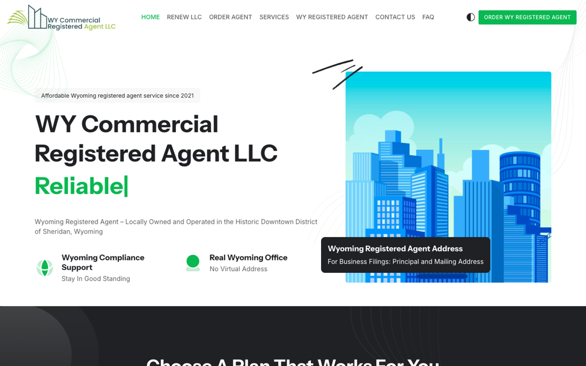
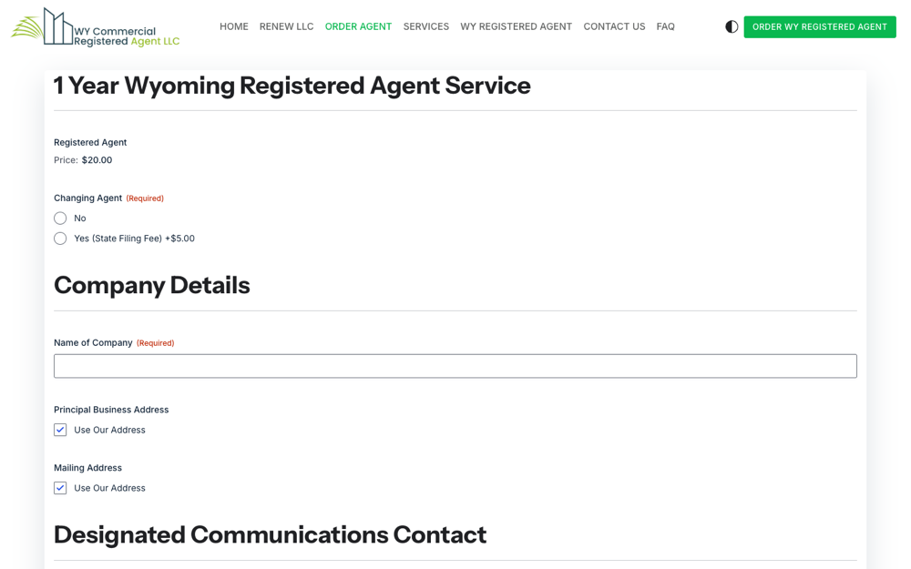
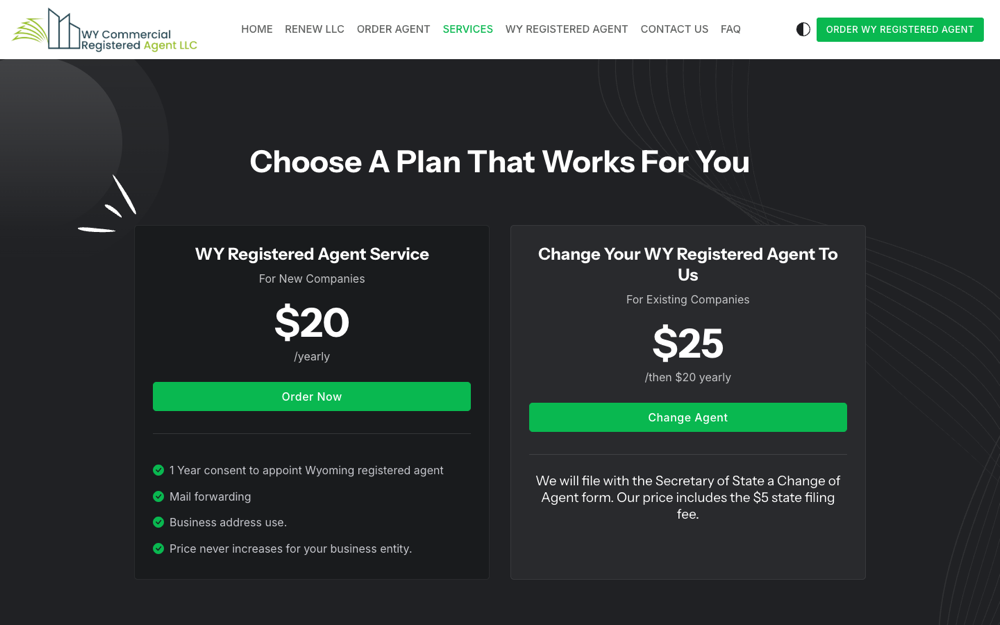
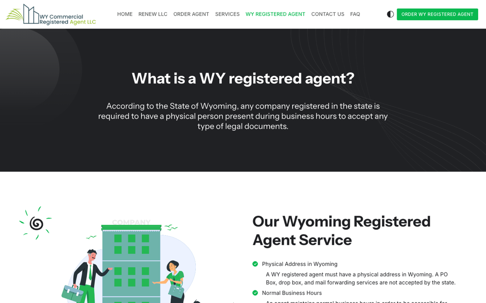
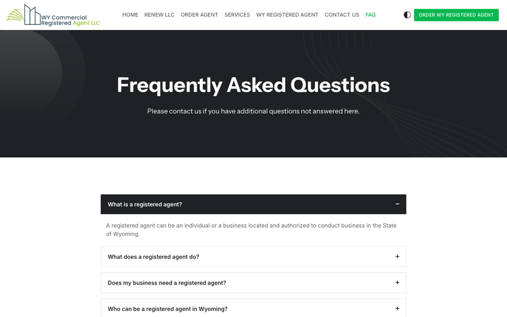
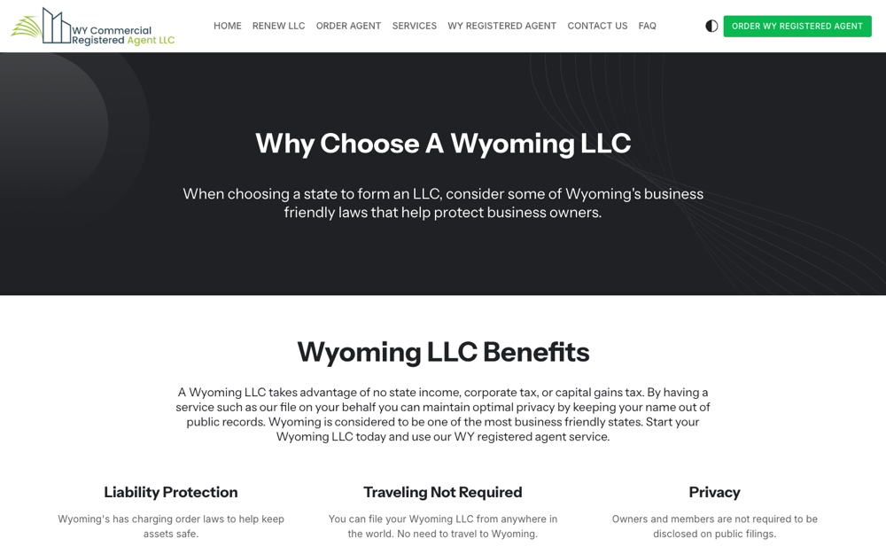
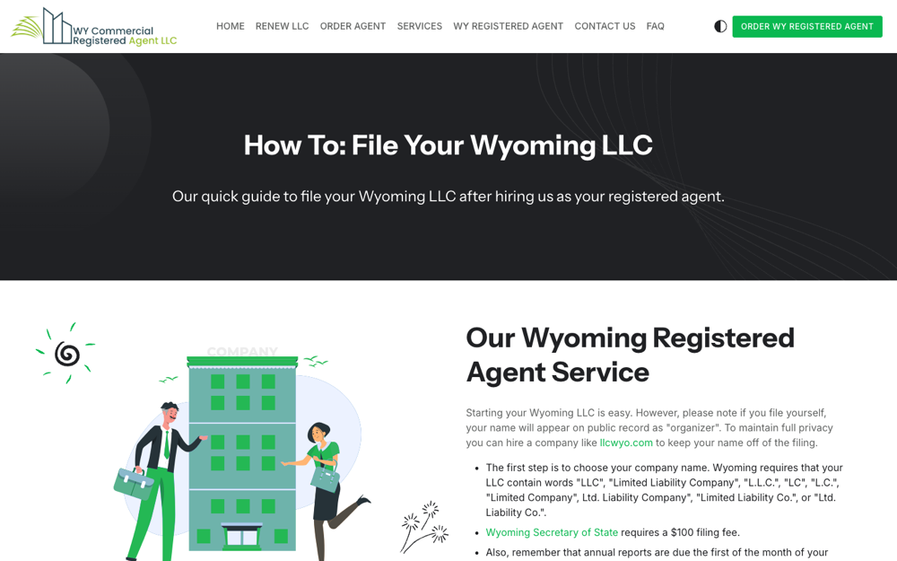

# Wyoming Commercial Registered Agent (WYCRA)

Laravel web platform for **Wyoming registered agent** services — marketing site, service ordering, Stripe payments, client portal, and admin order management.

**Live site:** [wycra.com](https://wycra.com/)

> Built by **Muhammad Usman** (Laravel / PHP) — marketing pages, order flow, payments, client/admin areas, and production delivery.

---

## What the product does

WYCRA helps businesses appoint a **Wyoming registered agent** with a real Sheridan, WY office address — compliance mail handling, privacy on public filings, and flat yearly pricing.

---

## Features

### Public website
- Home / landing with service value props
- Order registered agent flow
- Services & pricing
- “What is a registered agent?” education page
- Wyoming LLC benefits
- How to file a Wyoming LLC guide
- FAQ accordion
- Contact page
- Terms & conditions
- Light / dark theme toggle

### Commerce & orders
- Order agent / change agent checkout paths
- Stripe payment integration
- Promo code support
- Order success / confirmation flow
- Mail forwarding messaging (official mail scan & email)

### Client area
- Client dashboard
- Profile update
- Change password
- Plan subscribe / unsubscribe

### Admin
- Admin dashboard
- Orders management
- Pages / content management hooks
- Settings
- Document / attachment upload helpers
- PDF / Excel export tooling (DomPDF, Maatwebsite Excel)

---

## Tech stack

| Layer | Technology |
|-------|------------|
| Backend | **PHP 7.3/8**, **Laravel 8** |
| UI | Blade, Bootstrap 4, jQuery, Laravel Mix / Webpack |
| Payments | **Stripe** (`stripe/stripe-php`) |
| Cart | darryldecode/cart |
| Export | DomPDF, Maatwebsite Excel |
| Mail | Symfony Mailer / Laravel mail |
| Database | **MySQL** |

---

## Screenshots

### Home



### Order agent



### Services / pricing



### What is a registered agent?



### FAQ



### Contact


### Wyoming LLC benefits



### How to file a Wyoming LLC



---

## Local setup

```bash
composer install
cp .env.example .env
php artisan key:generate
# configure DB_* and Stripe keys in .env
php artisan migrate
npm install && npm run dev
php artisan serve
```

---

## Author

**Muhammad Usman** — Full-Stack Developer (Laravel / PHP)  
[GitHub](https://github.com/usman-wurfel) · [LinkedIn](https://www.linkedin.com/in/muhammad-usman-ali-311418221)
